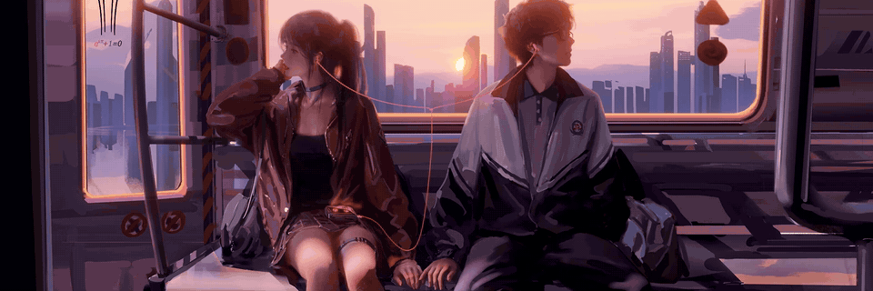
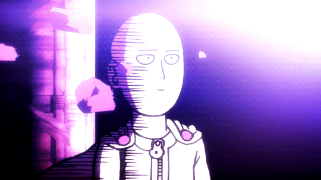
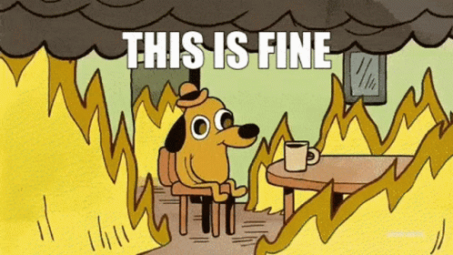

<!--
  PALETTE
  midnight  0B1026
  navy      14306B
  sky blue  5BC0EB   (swap for the exact Skate NSW hex if you have it)
  white     FFFFFF
-->

<!-- ===== MOVING BANNER (art: "Shuttle" by WLOP) ===== -->
<p align="center">
  
</p>

<!-- ===== NAME HEADER: dark version for dark mode, light version for light mode ===== -->
<p align="center">
  <picture>
    <source media="(prefers-color-scheme: dark)" srcset="https://capsule-render.vercel.app/api?type=waving&color=0:0B1026,55:14306B,100:5BC0EB&height=150&section=footer&reversal=true&text=Hi,%20I'm%20Kit&fontSize=50&fontColor=FFFFFF&animation=fadeIn&fontAlignY=40&desc=Exercise%20Scientist%20by%20day.%20Senior%20Vibe%20Engineer%20by%20night.&descAlignY=68&descSize=16">


<!-- ===== VIBE CODED INTRO ===== -->

```python
# Sure! Let's make you a simple README for GitHub 🚀
print("Hello, World!")
```

<p align="center">
  
  <br><sub>✨ This README was 100% vibe coded. I have reviewed approximately 0% of it.</sub>
</p>

<!-- ===== ABOUT ME + GIFS ON THE SIDE ===== -->

<h2>👨🏻‍💻 A Little Bit About Me</h2>

<table>
  <tr>
    <td width="62%" valign="top">

```yaml
name: kit
located_in: Sydney, NSW
current_job: Senior Vibe Engineer
education:
  [
    "Bachelor's in Applied Science (Exercise & Sport Science)",
  ]
company: Prompt & Pray Pty Ltd

fields_of_interests:
  [
    "Strength & Conditioning",
    "Sport Science",
  ]
technical_background:
  [
    "Gets stuff done",
    "Tactical acquisition expert",
  ]

currently_learning: ["why it worked yesterday"]
2026 Goals: ["make it work tomorrow too."]
hobbies: ["Gaming", "Anime", "Running (out of money)"]
```

</td>
    <td width="38%" align="center" valign="top">
      
      <br><sub><b>me when the code runs<br>and i understand none of it</b></sub>
      <br><br>
      
      <br><sub><b>me when the code doesn't run<br>(it's in production)</b></sub>
    </td>
  </tr>
</table>

<!-- ===== TOOLS ===== -->

<h2>🚀 Tools I Pretend To Understand</h2>
<p align="left">
  
  
  
  
  
  
</p>

<p align="left">
  
  
  
</p>

<!-- ===== PROOF (built by the GitHub Action in your repo) ===== -->

<h2>📊 Proof I Did Something</h2>
<p align="center">
  
  
</p>

<!-- ===== FOOTER (add more here later) ===== -->

<p align="center">
  
</p>
<p align="center">
  <picture>
    <source media="(prefers-color-scheme: dark)" srcset="https://capsule-render.vercel.app/api?type=waving&color=0:5BC0EB,45:14306B,100:0B1026&height=110&section=footer">
    
  </picture>
</p>
